<div align="center">
    <h1>MavuFlow Studio</h1>
    <p><strong>A practical workspace for exploring, transforming, and versioning datasets.</strong></p>
    <p>
        <a href="https://github.com/TshikhovhokhovhoPhathutshedzo/MavuFlow-Data-Engineering/actions/workflows/ci.yml"></a>
        
        
        
    </p>
</div>

MavuFlow Studio combines dataset uploads, data quality insights, transformations, and repeatable pipelines in one full-stack application.

## What You Can Do

| Workspace | Capabilities |
| --- | --- |
| **Datasets** | Upload CSV and Excel `.xlsx` files, inspect metadata, and manage versions. |
| **Data preparation** | Clean columns, transform data, and preview the output. |
| **Code Lab** | Apply supported pandas and NumPy expressions; preview first, then explicitly save changes as a new dataset version. |
| **Pipelines** | Build and run ordered transformation workflows. |
| **Quality and exports** | Review dataset analytics and quality reports, then export results. |
| **Accounts** | Authenticated workspaces with user-scoped project and dataset access. |

## Feature Guide

- **Accounts and projects:** Register or sign in, then create projects that keep related datasets organized.
- **Dataset uploads:** Import CSV or Excel `.xlsx` files. MavuFlow records file metadata and provides dataset previews and profiles.
- **Cleaning and transformations:** Apply supported cleaning operations, rename or derive columns, and inspect the resulting preview.
- **Code Lab:** Write supported pandas and NumPy expressions against `df`. Run a preview without changing the stored dataset, then choose **Save changes** to create a new version. Code is not persisted, and arbitrary Python, imports, and file or network access are not allowed.
- **Pipeline Builder:** Save ordered transformation steps and run them against a selected dataset.
- **Analytics and quality:** Inspect dataset dimensions, missing values, duplicates, and quality scores.
- **History and exports:** Review saved dataset versions and download processed data in supported formats.

## Screenshots

The screenshots below show the main application workflows. Account identifiers have been removed from these copies.

<details>
<summary>Open the 13-screen MavuFlow gallery</summary>

<p align="center">
    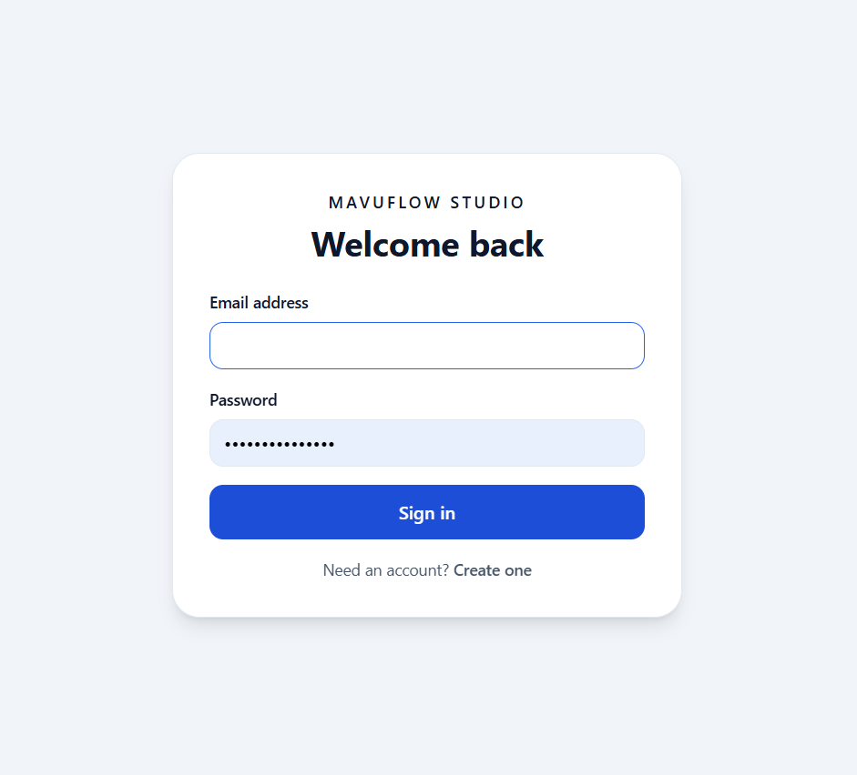
    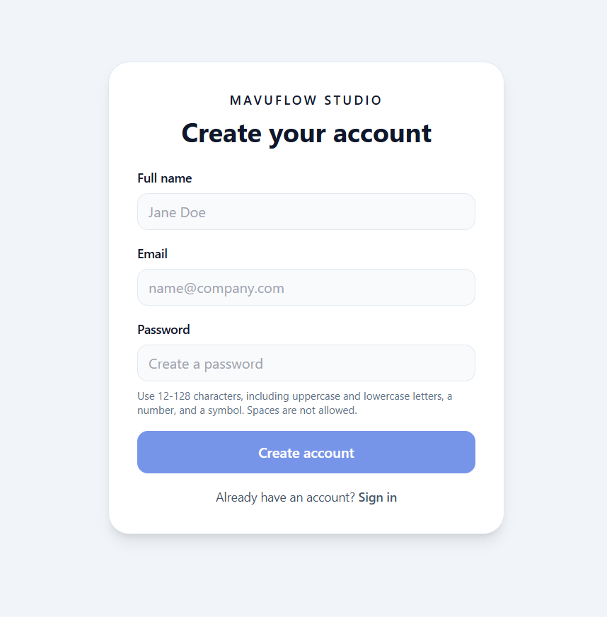
</p>
<p align="center"><sub>Sign in and create an account</sub></p>

<p align="center">
    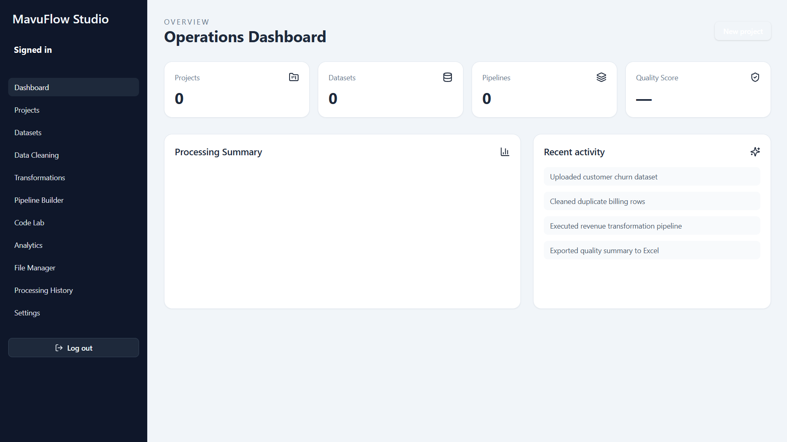
    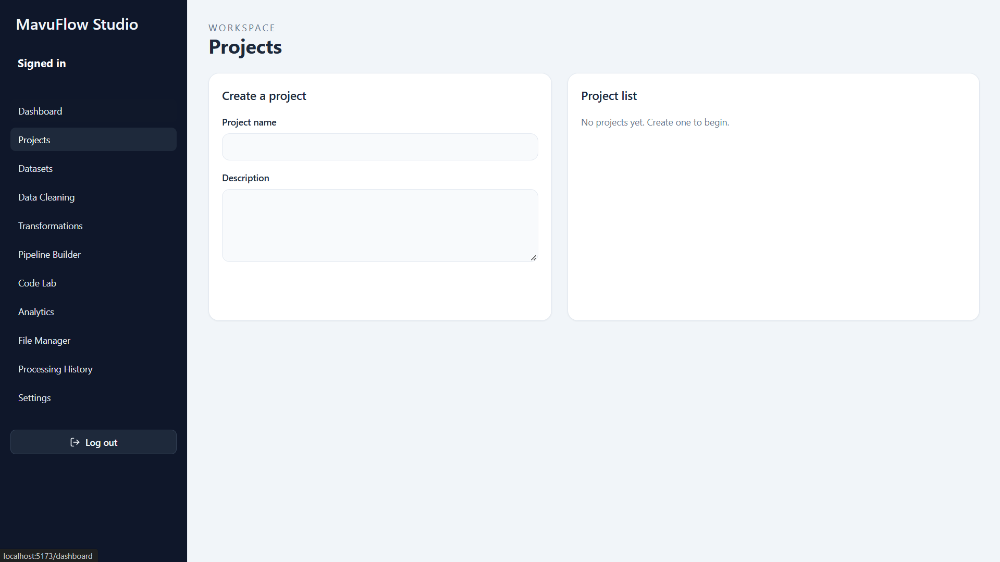
</p>
<p align="center"><sub>Dashboard overview and project management</sub></p>

<p align="center">
    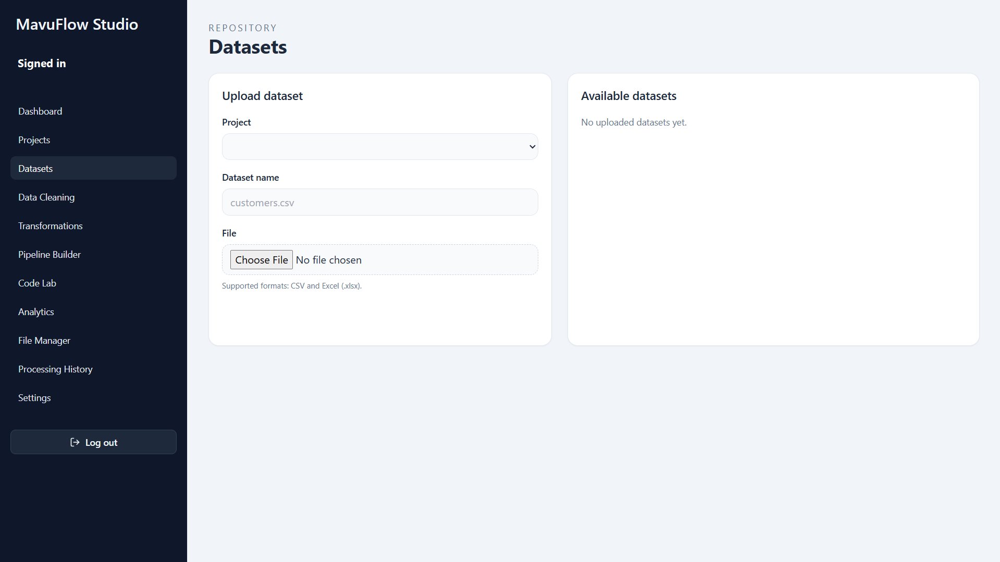
    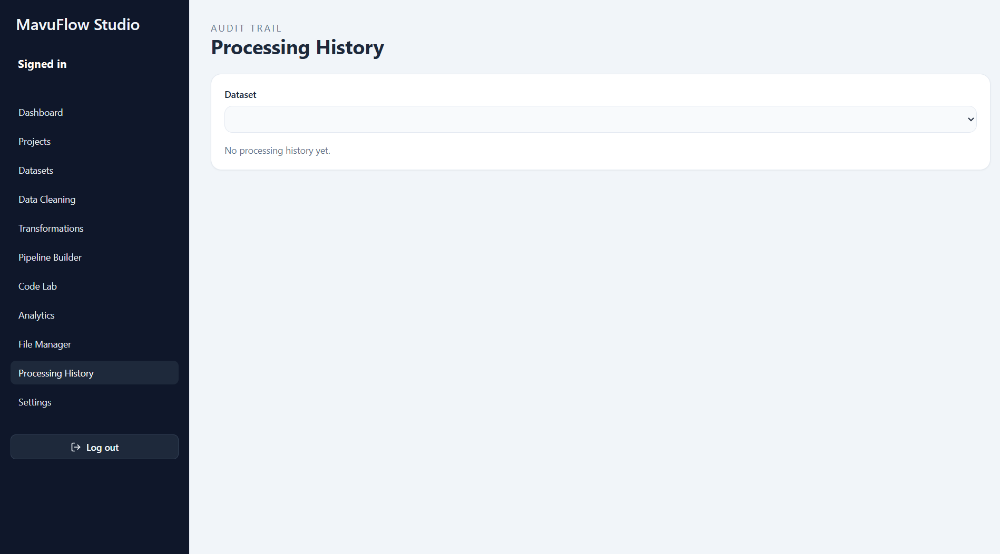
</p>
<p align="center"><sub>Upload datasets and review their version history</sub></p>

<p align="center">
    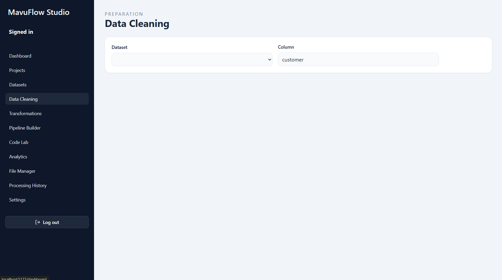
    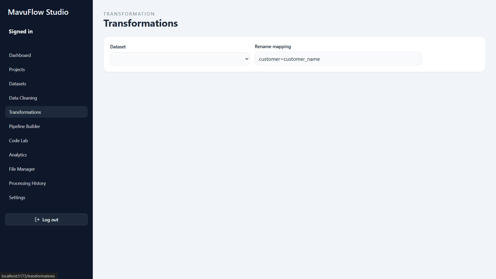
</p>
<p align="center"><sub>Clean and transform dataset columns</sub></p>

<p align="center">
    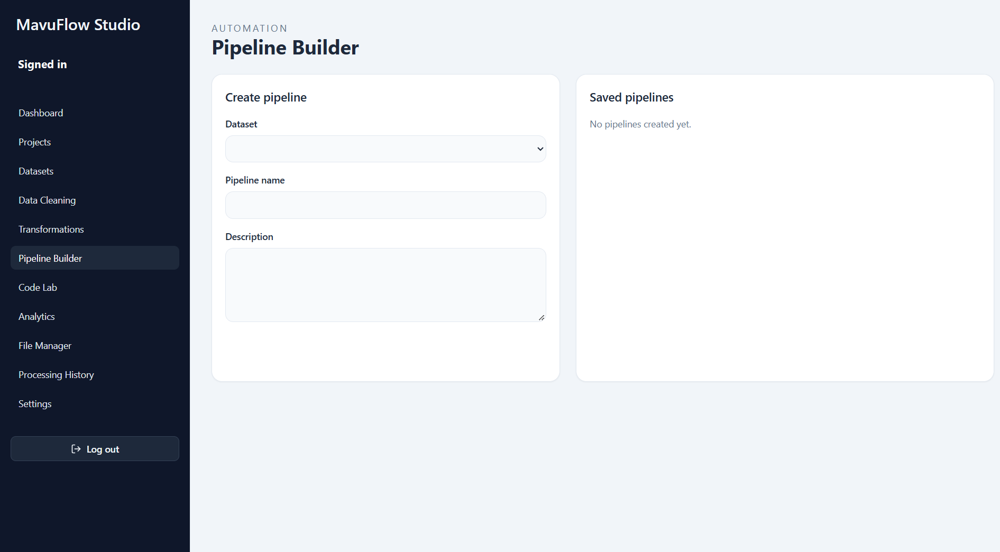
    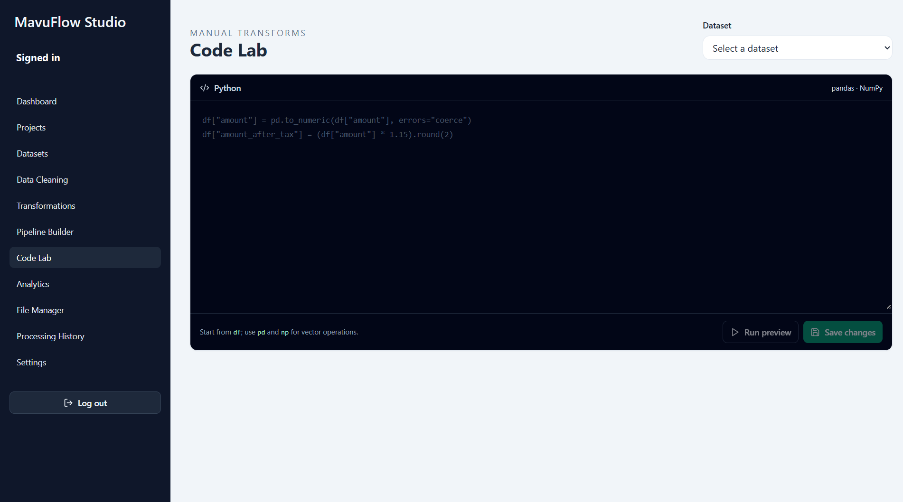
</p>
<p align="center"><sub>Build repeatable pipelines or write manual data operations</sub></p>

<p align="center">
    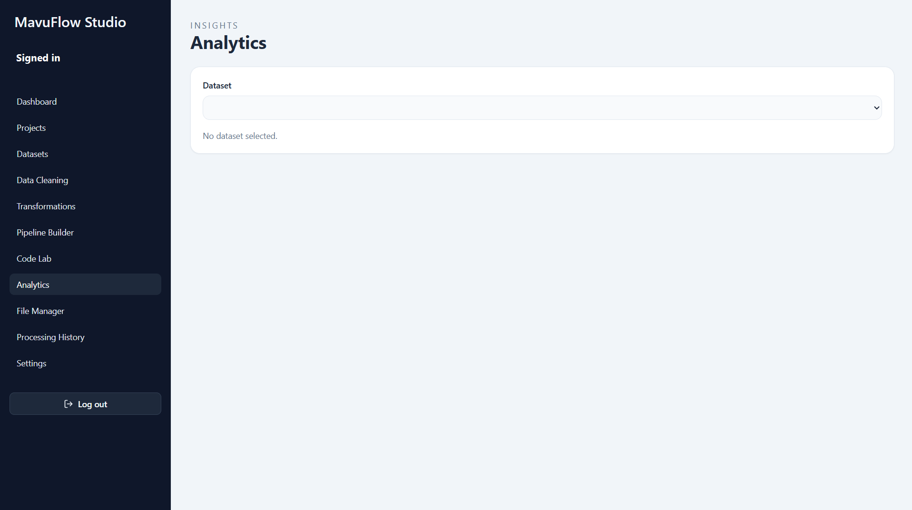
    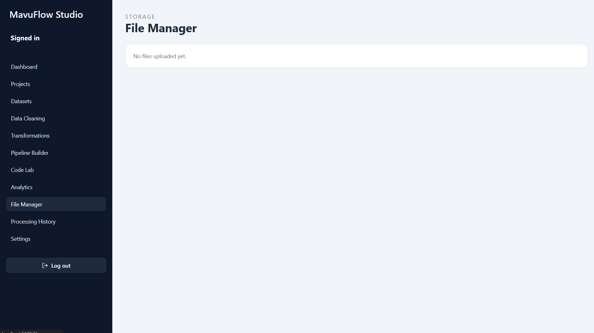
</p>
<p align="center"><sub>Review quality analytics and manage exported files</sub></p>

<p align="center">
    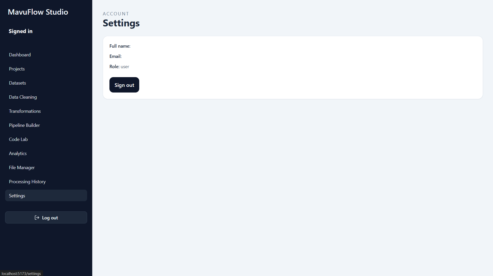
</p>
<p align="center"><sub>Account settings</sub></p>

</details>

## Technology

| Layer | Stack |
| --- | --- |
| Frontend | React, TypeScript, Vite, Tailwind CSS, TanStack Query |
| API | Python 3.12, FastAPI, Pydantic, SQLAlchemy |
| Data processing | pandas, NumPy |
| Persistence | PostgreSQL; local filesystem storage for development |
| Background services | Celery and Redis |
| Local orchestration | Docker Compose and NGINX |

## Architecture

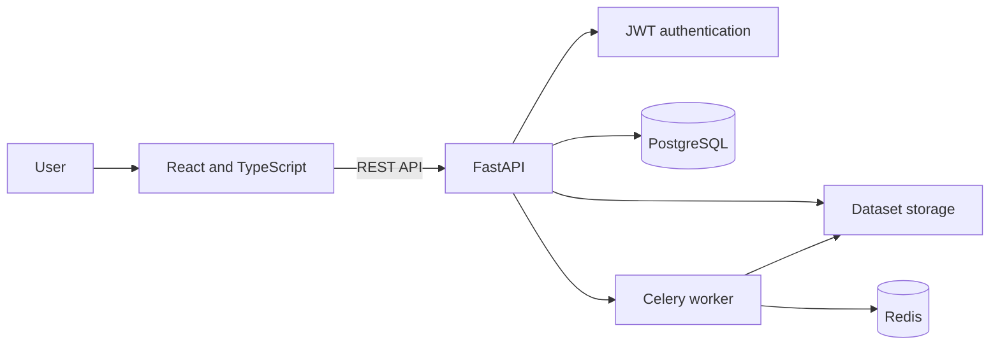

## Data Model

The diagram reflects the tables currently created by the application.

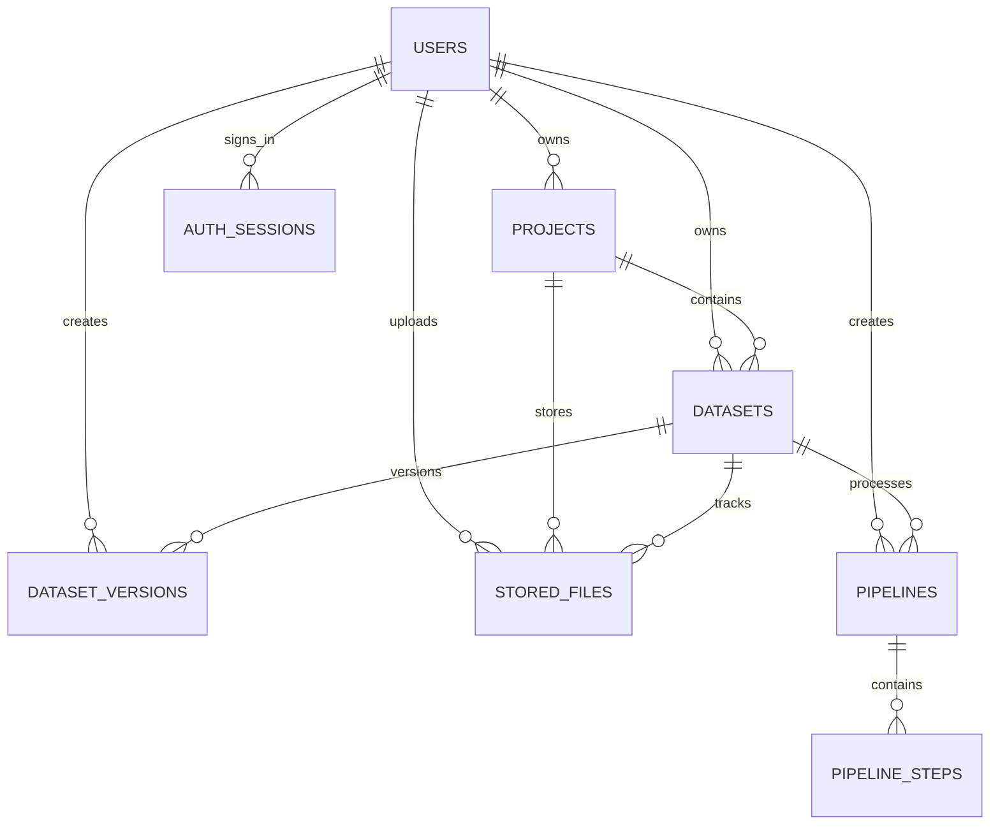

## Run Locally

### Option 1: Docker Compose

Requires Docker Desktop with Compose enabled.

```bash
git clone https://github.com/TshikhovhokhovhoPhathutshedzo/MavuFlow-Data-Engineering.git
cd MavuFlow-Data-Engineering
docker compose up --build
```

Open the frontend at [http://localhost:5173](http://localhost:5173). The API is at [http://localhost:8000](http://localhost:8000), with interactive API documentation at [http://localhost:8000/docs](http://localhost:8000/docs).

### Option 2: Run Frontend and API Separately

Requires Python 3.12 and Node.js 20 or newer. In one terminal:

```bash
cd backend
python -m pip install -r requirements.txt
python -m uvicorn app.main:app --reload
```

In a second terminal:

```bash
cd frontend
npm install
npm run dev
```

Without a local backend `.env`, the API uses SQLite for development. Configure `DATABASE_URL`, `JWT_SECRET_KEY`, and `CORS_ORIGINS` through environment variables for a non-local deployment. Never commit `.env` files or production credentials.

## Deployment Notes

The included Compose stack runs the frontend, API, PostgreSQL, Redis, worker, and NGINX. See the [deployment guide](docs/deployment/README.md) for health checks and production notes.

Supabase can provide PostgreSQL and object storage, but it does not host this FastAPI service or the full React application. Deploy the frontend and API to application hosts, configure the API to use the Supabase database, and move uploaded files from local filesystem storage to persistent object storage before production use.

## CI

GitHub Actions runs the backend pytest suite and frontend production build on pushes to `main` and pull requests. See the [CI workflow](.github/workflows/ci.yml).

## Project Status and Contributions

MavuFlow Studio is a project under construction and has not yet been deployed. Contributions, feedback, and improvements are more than welcome; please open an issue or pull request to get involved.
