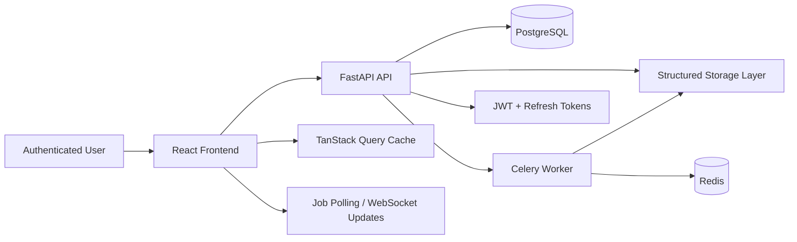
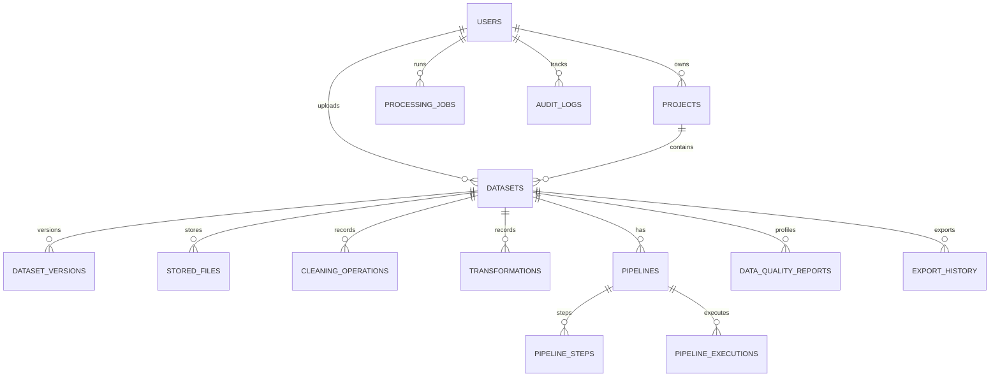

# MavuFlow Studio

MavuFlow Studio is a full-stack data engineering platform for uploading datasets, profiling quality, cleaning data, building ETL pipelines, versioning datasets, and exporting processed outputs.

## Architecture Overview

The application follows a modular monorepo structure with separate frontend, backend, storage, infrastructure, and documentation layers.

- Frontend: React + TypeScript + Vite + Tailwind + TanStack Query
- Backend: FastAPI + SQLAlchemy + Pydantic + Celery + Redis
- Database: PostgreSQL
- Storage: structured local filesystem for development; S3-compatible abstraction for production
- Processing: backend data services and Celery workers for asynchronous operations
- Runtime: Docker Compose for local orchestration and NGINX as the reverse proxy

## System Architecture



## Database Relationship Model



## Storage Design

The application stores files in a user-scoped hierarchy to preserve originals, processed versions, exports, and reports:

```text
storage/
├── users/
│   └── {user_uuid}/
│       └── projects/
│           └── {project_uuid}/
│               └── datasets/
│                   └── {dataset_uuid}/
│                       ├── original/
│                       ├── versions/
│                       ├── exports/
│                       ├── reports/
│                       └── metadata/
├── temporary/
└── system/
```

All generated file names are internal UUID-based identifiers. The original filename is retained as metadata in PostgreSQL and is never used to build storage paths.

## Development Phases

1. Foundation
2. Authentication
3. Project and file management
4. Dataset preview and profiling
5. Cleaning engine
6. Live processing and versioning
7. Transformation engine
8. Pipeline builder
9. Export system
10. Analytics and quality reporting
11. Testing
12. Deployment and documentation

## Getting Started

See the project documentation in the docs folder and the environment configuration in .env.example.

## Deployment and CI

The repository includes a containerized deployment stack and a GitHub Actions pipeline for automated validation:

- Docker Compose orchestrates backend, frontend, PostgreSQL, Redis, worker, and NGINX
- CI runs the backend pytest suite and the frontend production build on pull requests and main-branch pushes
- Deployment notes are available in [docs/deployment/README.md](docs/deployment/README.md)

## Current Status

The platform has progressed through the core backend and analytics milestones, with the testing and deployment hardening layer in place and documented for local and production use.
